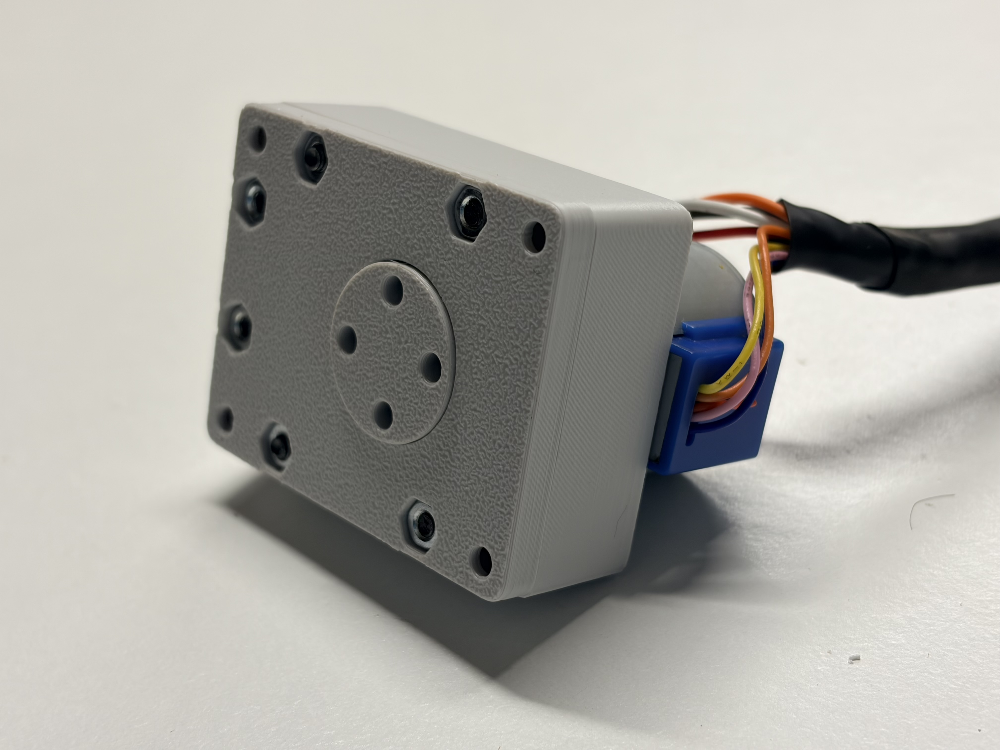
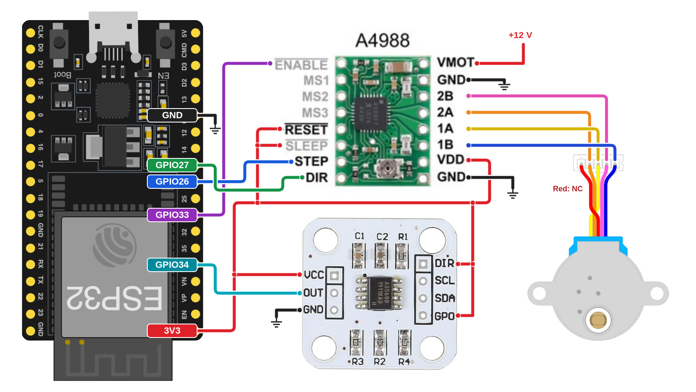
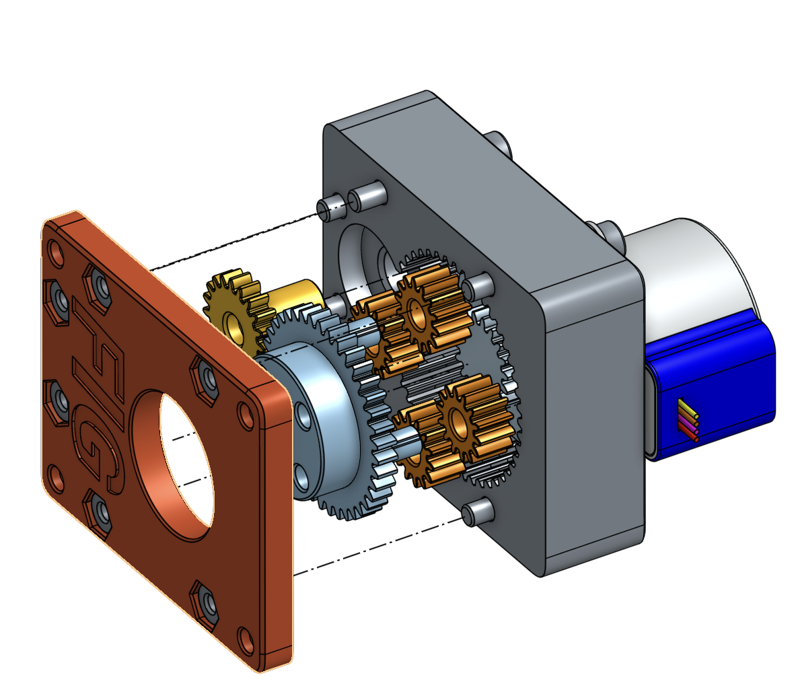
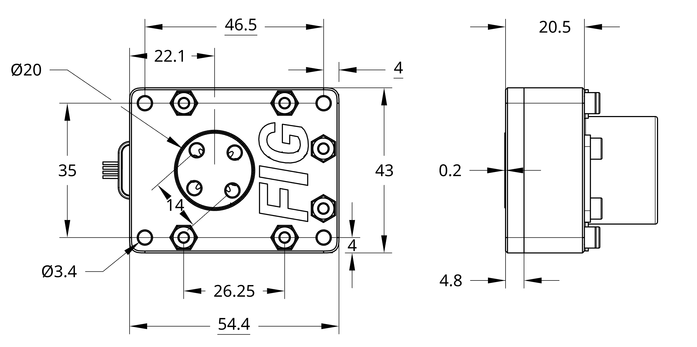

# AS5600 Closed Loop Stepper

**[Assembly video on YouTube](https://youtu.be/rkmWiIObhU0)
[STEP/STL files](https://makerworld.com/en/models/3696165-closed-loop-28byj-48-planetary-drive-with-as5600)**

Control up to four A4988-driven steppers with an ESP32 using the AS5600 magnetic encoder's analog or I2C feedback. Supports multi-turn moves, active hold, and pulse-counted open-loop moves.



## Install

- **Arduino IDE** — Install the release ZIP via **Sketch → Include Library → Add .ZIP Library**. Select an original ESP32 board and open `SerialConsole` or `TwoDrives` from the library examples.
- **PlatformIO** — Add the release tarball to `lib_deps` with `file:///path/to/release.tar.gz`. Run `pio run` from the repository to build `SerialConsole`.

## Wiring

| Connection | Default ESP32 GPIO |
| --- | --- |
| A4988 STEP | 26 |
| A4988 DIR | 27 |
| A4988 EN (active low) | 33 |
| AS5600 OUT (analog, default) | 34 |
| AS5600 SDA (I2C) | 21 |
| AS5600 SCL (I2C) | 22 |

Use 3.3 V logic, a common ground, and a 10 kΩ pull-up on EN. Set the driver current limit and match `driver.microsteps` to the MS pins. The red wire on the 28BYJ-48 stepper is left disconnected in order to drive it in bipolar mode. Up to 12V can be safely applied provided the potentiometer on the A4988 is adjusted appropriately. A good starting Vref measurement between the potentiometer of the A4988 and GND is 0.12V when using Vmot=12V.



## Usage

```cpp
#include <AS5600ClosedLoopStepper.h>

ClosedLoopStepper motor;

void setup() {
    Serial.begin(115200);
    ClosedLoopStepper::Config config;
    config.motion.fullStepsPerOutputTurn = 200;
    config.motion.encoderTurnsPerOutputTurn = 1;
    config.motion.maxFullStepsPerSecond = 100;

    auto result = motor.begin(config);
    if (result == ClosedLoopStepper::Result::Ok) result = motor.moveRelativeDegrees(90);
    Serial.println(ClosedLoopStepper::resultMessage(result));
}

void loop() {
    motor.update();
}
```

This sketch assumes a direct-drive 1.8° motor with the encoder on its shaft. Set the gearing to match your hardware. Set `encoder.polarity` to `+1` for counts that rise on positive travel, `-1` for falling counts, or `0` to learn on the next nonzero move. For analog calibration, set `adcMin` and `adcMax`.

Call `update()` every loop from the task that calls `begin()`. The control period is 10 ms. The STEP watchdog stops pulses after 60 ms without a rate update.

See the [API reference](#api-reference) for motion commands and diagnostics.

Run `SerialConsole`, open the serial monitor at **115200 baud**, and enter `help`. [SerialConsole sketch](examples/SerialConsole/SerialConsole.ino)

## Multiple drives

Give each drive its own STEP, DIR, EN, and encoder connections. Call every controller from the same task and service each with `update()`. On Arduino-ESP32 2.x, assign a distinct free `driver.timerNumber` (0–3). On 3.x, the core allocates timers. `begin()` reports resource conflicts as `Result::InUse`.

Use a separate ADC pin for each analog encoder. For I2C, set `encoder.mode` to `FeedbackMode::I2C`. The AS5600 uses address `0x36`, so each I2C encoder needs its own SDA/SCL pair. Set `encoder.i2cBusNumber` to `0` for `Wire` or `1` for `Wire1`. For an application-managed bus, pass an initialized `encoder.sharedWire` and reserve its pins in your application.

[TwoDrives](examples/TwoDrives/TwoDrives.ino) starts two analog-feedback moves at boot.

## API reference

`ClosedLoopStepper` is the controller class. Include `<AS5600ClosedLoopStepper.h>` and create one instance per drive. The library uses `StepperMotion` for STEP timing, `As5600Bus` for I2C feedback, and `As5600Analog` for ADC feedback internally. [Public header and defaults](src/AS5600ClosedLoopStepper.h)

### Configuration

Pass a `ClosedLoopStepper::Config` to `begin(config)`. It groups three configuration types.

| Type | Member | Settings |
| --- | --- | --- |
| `DriverConfig` | `config.driver` | STEP, DIR, and EN pins, direction level, microsteps (1, 2, 4, 8, or 16), and timer index on Arduino-ESP32 2.x. |
| `EncoderConfig` | `config.encoder` | Feedback mode, ADC pin and calibration, I2C pins, bus, frequency and timeout, and polarity. |
| `MotionConfig` | `config.motion` | Motor full steps and encoder turns per output turn, speed and ramp limits, target and hold tolerances, and fault timeouts. Tolerances use encoder counts (`countsPerEncoderTurn` is 4096). |

### Methods

| Method | Behavior |
| --- | --- |
| `begin()`, `begin(config)` | Initialize with default or supplied settings. |
| `update()` | Service motion and feedback each loop. |
| `end()` | Stop and release hardware resources. |
| `moveRelative(turns)`, `moveRelativeDegrees(degrees)` | Move by a signed output-shaft offset. Holds on arrival by default. |
| `holdRelative(turns = 0)`, `holdRelativeDegrees(degrees = 0)` | Move by an offset and hold. Zero holds in place and requires known encoder polarity. |
| `moveOpenLoop(turns)`, `moveOpenLoopDegrees(degrees)` | Send the calculated STEP pulses and release the driver on completion. |
| `stop()` | Cancel motion or hold, clear the fault, and release the driver. |
| `setMaxSpeed(speed)`, `setMaxAcceleration(accel)`, `setMaxDeceleration(decel)` | Change limits during or between moves. Use motor full steps/s for speed and full steps/s² for acceleration and deceleration. |
| `status()`, `config()` | Get a `Status` snapshot or read the current configuration. |
| `onEvent(handler, context = nullptr)` | Register an `EventHandler` for completion, hold recovery, stall, feedback, and fault events. |
| `setFeedbackMode(mode)` | Switch between `FeedbackMode::Analog` and `FeedbackMode::I2C` while stopped and released. |
| `readEncoder(reading)` | Fill an `EncoderReading` with the angle and ADC or magnet status. I2C read failures include `I2cFailure` details. |
| `readAutomaticGain(gain)` | Read the I2C automatic gain while idle. |
| `resultMessage(result)`, `stateMessage(state)`, `version()` | Get printable text for a `Result`, a `State`, or the library version. |

### Status and events

A move returning `Result::Ok` means the controller accepted the command. Use `status().state` or an event to track completion. `Status` includes STEP counts, feedback age, and fault details. Read `measuredTurns` and `errorTurns` when `positionKnown` is true. Use `status().encoderAngle` for the latest qualified angle during closed-loop motion.

An `EventHandler` receives `(Event event, const Status& status, void* context)`. `Reached` reports arrival, `OpenLoopComplete` reports pulse-counted completion, and `Fault` reports an abort. Keep callbacks short and issue new commands from the application loop.

## Drive assembly





## License

[GPL-3.0-only](LICENSE)
